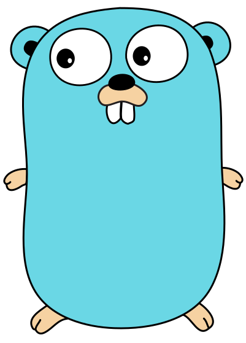
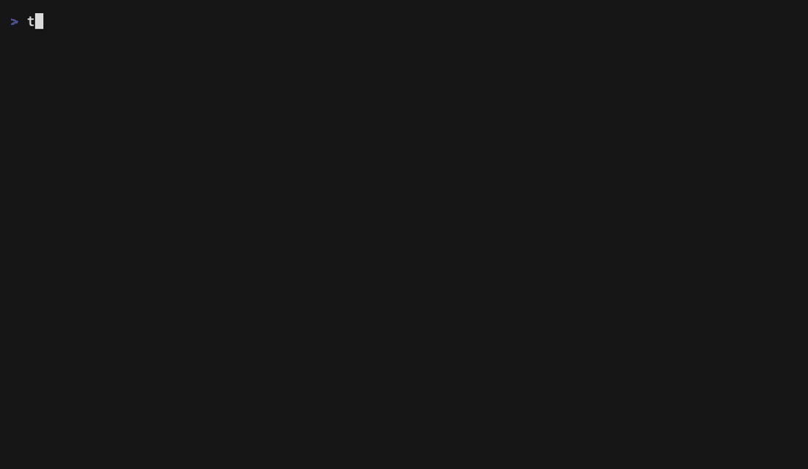
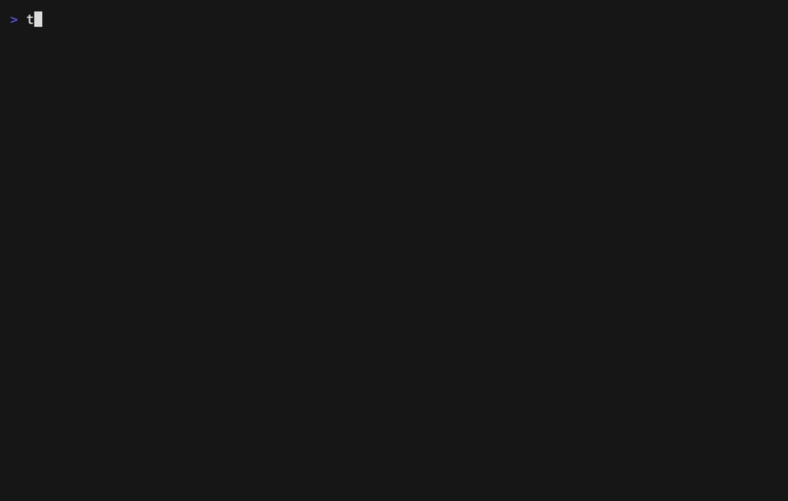

# tflings

<p align="center"> &nbsp;&nbsp; </p>

[](https://github.com/cleonte/tflings/actions/workflows/ci.yml) [](https://github.com/cleonte/tflings/releases/latest) [](LICENSE) [](go.mod) [](https://developer.hashicorp.com/terraform/tutorials/certification-004/associate-review-004)

Learn Terraform by fixing small broken exercises, like [Rustlings](https://github.com/rust-lang/rustlings), for the **HashiCorp Terraform Associate (004)** exam. It is a sibling of [k8slings](https://github.com/cleonte/k8slings) and [golings](https://github.com/cleonte/golings).

You get a folder of Terraform files with a `# I AM NOT DONE` line and a `# TODO:` where something is wrong. You fix them, save, and tflings tells you what Terraform says and what is still not right. Exercises that build things use the real `hashicorp/aws` provider against [Floci](https://github.com/floci-io/floci), a free local AWS emulator that tflings runs in Docker. Nothing ever talks to a real AWS account.



> **Status: early releases, expect rough edges.** 97 exercises in five modes (quiz, plan, apply, fix, and `cli`, where you write one command), every objective of the Terraform Associate 004 content list covered, a mock exam with 183 questions, and `tflings progress`. Tested on macOS and Linux; Windows with Docker is untested. See [ROADMAP.md](ROADMAP.md) and the [changelog](CHANGELOG.md).

## The first five minutes

```bash
brew install cleonte/tap/tflings        # or: go install github.com/cleonte/tflings/cmd/tflings@latest
tflings doctor --install-terraform      # only if you have no Terraform 1.12 or newer
mkdir ~/tflings-play && cd ~/tflings-play
tflings init && cd tflings-exercises
tflings watch                           # fix the exercise, save, see the result
```

The mock exam needs nothing else, not even a folder:

```bash
tflings exam --practice -n 10     # the answer and why, after each question
tflings progress                  # exercises done and exam score, per objective
```



## What you need

- **Terraform 1.12 or newer** (the exam tests 1.12). tflings uses the one on your `PATH`, or the one in `TFLINGS_TERRAFORM`, or one it downloads for you into its own folder with `tflings doctor --install-terraform`.
- **Docker** (Docker Desktop, OrbStack, Colima, Lima or Docker Engine) for exercises that use the AWS provider. Quizzes and exercises that need no cloud run without it.
- Go 1.26 or newer, only if you build tflings yourself (`go install`); the Homebrew install and the release archives need no Go.

`tflings doctor` checks all of this and says how to fix what is missing.

## Try it

On macOS with Homebrew:

```bash
brew install cleonte/tap/tflings
```

Or download the archive for your system from the [releases](https://github.com/cleonte/tflings/releases) page. Or, with Go 1.26 or newer:

```bash
go install github.com/cleonte/tflings/cmd/tflings@latest   # puts tflings in $(go env GOPATH)/bin
mkdir ~/tflings-play && cd ~/tflings-play
tflings init            # creates ./tflings-exercises
cd tflings-exercises
tflings doctor          # what works on this machine, and what to fix
tflings watch           # full-screen view: edit a file, save, see the result
```

Make sure `$(go env GOPATH)/bin` is on your `PATH`. To work on tflings itself, clone the repository and run `make build`, which writes `bin/tflings`.

For exercises that use the AWS provider, once:

```bash
tflings aws up              # starts Floci in Docker (pulls about 370 MB the first time)
tflings doctor --prefetch   # downloads the AWS provider (about 250 MB) so exercises start offline
```

## Commands

| Command | What it does |
|---|---|
| `init [dir]` | Write the exercises into a folder. Never overwrites your work. |
| `watch` | Full-screen view that checks the next exercise whenever you save. `--plain` for line mode. |
| `run next` / `run <name>` | Check one exercise. |
| `hint <name>` | Show the hint and the documentation link. |
| `list` | Exercises by topic, with progress. |
| `verify` | Check every exercise in order. |
| `reset <name>` | Put an exercise back as it was. It gets a fresh, empty fake AWS account. |
| `solution <name>` | Show the solution (hidden while the exercise is pending, unless you ask). |
| `progress` | Readiness per exam objective: exercises done (inside your exercises folder) and mock exam score. `exam --weak` then asks about the lowest ones. |
| `doctor --install-terraform` | Downloads Terraform (the newest 1.12.x by default) into tflings's own folder, checking its checksums and signature. For machines that have none. |
| `exam` | Mock exam: multiple choice questions, scored per objective, with the exercises to redo (`--objective 4g`, `--practice`, `--review` for the questions you missed, `-n 30`, `--minutes 60`). Works anywhere, needs no Terraform or Docker. |
| `tf <name> <terraform args>` | Fix exercises: run Terraform in the exercise's sealed environment (`tflings tf drift1 plan`). |
| `sandbox [terraform args]` | A scratch folder with a fake AWS account of its own, in the same sealed environment: try Terraform freely (`tflings sandbox init`, `tflings sandbox --reset` to start over). |
| `env <name>` | Print that environment, for a shell of your own. |
| `update` | Add the exercises your folder does not have yet, and refresh the `info.toml` entries (objective, hint, link) of the ones you have. READMEs and exercise files you have not changed are replaced by the newer ones; files you have edited are never overwritten (`reset` brings the new one). The old `info.toml` is kept as `info.toml.bak`. |
| `aws up\|down\|status\|reset` | Manage the local AWS (Floci). |
| `doctor [--prefetch]` | Check this machine. |

## How it works

- **Plan mode** copies your exercise to a scratch folder, runs `terraform init`, `plan` and `show -json`, and checks the result with [CEL](https://cel.dev) expressions that live inside the binary (so they are not a spoiler). Some checks plan again with other variable values, so writing the expected answer by hand does not pass.
- **Terraform runs in a boundary.** It gets an environment built from nothing (your shell's variables are not copied), a wall-clock timeout, a cap on its output, and fake credentials. A check refuses `provider "aws"` and `backend "s3"` blocks that name a profile, keys, a role, or an endpoint other than the local Floci.
- **One fake AWS account per exercise.** Floci uses a 12-digit access key ID as the account, so exercises never see each other's resources.

The design and the experiments behind it are in [CLAUDE.md](CLAUDE.md) and [spikes/](spikes/).

## Known limits

- The `aws` provider needs `<account>.localhost` to resolve (one call of the provider sends to that name). Docker's and most desktop systems' DNS do this; if yours does not, `tflings doctor` prints the exact `/etc/hosts` lines to add.
- Tested on macOS (Apple silicon), Linux arm64 and Linux x86_64 with native Docker, on Terraform 1.12.2 and 1.17.2. Windows ran the exercises that need no AWS in CI; Windows with Docker, and Intel Macs, are untested.
- "Bucket name already taken" cannot be taught with Floci (its S3 names are per account), so those are quiz questions.

## Contributing and security

Issues and pull requests are welcome: see [CONTRIBUTING.md](CONTRIBUTING.md). To report a way out of the sandbox, see [SECURITY.md](SECURITY.md).

## License

Apache-2.0, see [LICENSE](LICENSE) and [NOTICE](NOTICE). Floci is MIT licensed and is downloaded, not included.

The Go gopher was designed by [Renee French](http://reneefrench.blogspot.com/); the vector in `misc/gopher.svg` is by Takuya Ueda, [CC BY 3.0](https://creativecommons.org/licenses/by/3.0/). The Terraform mark in `misc/terraform.svg` is from [Simple Icons](https://simpleicons.org/) (CC0). Go is a trademark of Google LLC and Terraform is a trademark of HashiCorp, Inc.
